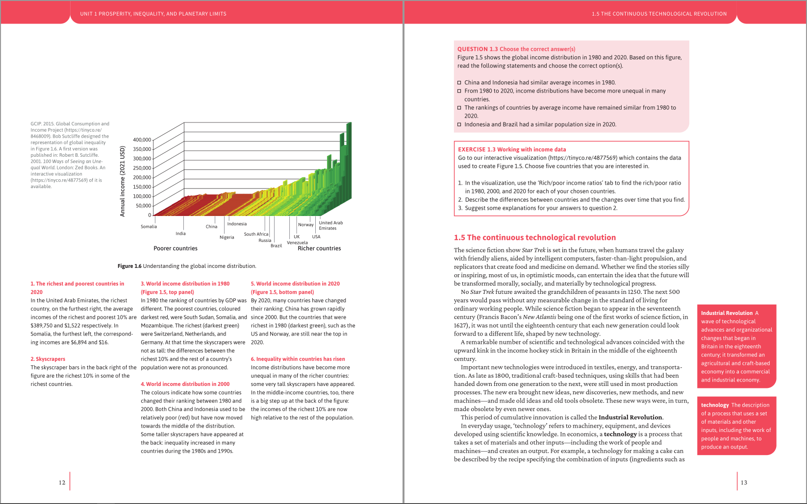

# Prince PDF demo: complex print layout from HTML and CSS

This repo shows how we use [PrinceXML](https://www.princexml.com/) to turn semantic HTML and CSS into a book-quality print PDF, with running headers, margin footnotes, page floats, cross-references, and PDF bookmarks. We build it with the [Electric Book template](https://github.com/electricbookworks/electric-book) (EBT) at [Electric Book Works](https://electricbookworks.com).

The sample is Unit 1 of CORE Econ's [*The Economy 2.0: Microeconomics*](https://books.core-econ.org/the-economy/).

## The rendered output

[`microeconomics-print-pdf.pdf`](microeconomics-print-pdf.pdf) is the PDF Prince produced from the source below. This is our standard print-PDF output, but with crop marks, bleed, and trim turned off.



## The source

The original source – markdown files in a Jekyll setup based on the Electric Book template – is maintained in a private repo. The source shown here is what the template has generated for Prince to render.

```
source/
  microeconomics-sample.html   the HTML Prince rendered
  styles/
    print-pdf.css              the full compiled stylesheet (beautified)
    print-pdf.prince.css       curated, annotated excerpt – start here
  js/
    main.dist.js               the behaviour bundle, unminified (dev build)
```

These files are here to read, not to rebuild the PDF. The HTML loads its images from our media server, and the stylesheet expects fonts, a colour profile, and hyphenation files that are not included.

`source/microeconomics-sample.html` is the single HTML file Prince renders: EBT merges the unit's pages into one document. We stripped the build-time search-index metadata and ran it through Prettier so you can read it. It still links to `styles/print-pdf.css`.

`source/styles/print-pdf.css` is the complete compiled stylesheet, reformatted from the minified build output (about 600 KB, now readable).

`source/styles/print-pdf.prince.css` is the file to read first. It is a pretty-printed excerpt of just the Prince-specific rules, and each rule carries a comment naming the technique. So this is where you can see how the layout is done.

## Prince techniques

See `print-pdf.prince.css` for selected annotated rules:

- Page geometry – `@page` size and margins, `:first`/`:left`/`:right` pages, and named pages (`page: cover-page`) for front-matter numbering.
- Running headers and footers – `string-set` captures headings into named strings, and margin boxes print them with `content: string(...)`.
- Document settings – `prince-pdf-*` for two-page spreads, bookmark display, and PDF/X colour output.
- Footnotes – `float: footnote` and the Prince footnote area.
- Cross-references – `target-counter()` and `target-text()`, so 'see Figure 1.1' resolves to the right number and page.
- Page floats – `-prince-float: wide outside` places sidenotes and wide figures in the margin.
- PDF bookmarks – `bookmark-level` builds the PDF outline.

## A note on JavaScript

Webpack bundles the book's behaviour from the [`core-book-modules` npm package](https://github.com/electricbookworks/core-book-modules/), and the repo's JS entry is a single import. The production build minifies and mangles that bundle. For this demo we rebuilt it in webpack's development mode instead, so `source/js/main.dist.js` keeps its original function names and labels each module with its source path. It is still transpiled to ES5 for Prince, because that transform is keyed on the print-pdf output, not on the build mode. The JavaScript does little in the PDF, so it is here only for completeness.

## Credits and rights

- Book content © CORE Economics Education, included here for technical demonstration.
- Made with the Electric Book template and PrinceXML.
